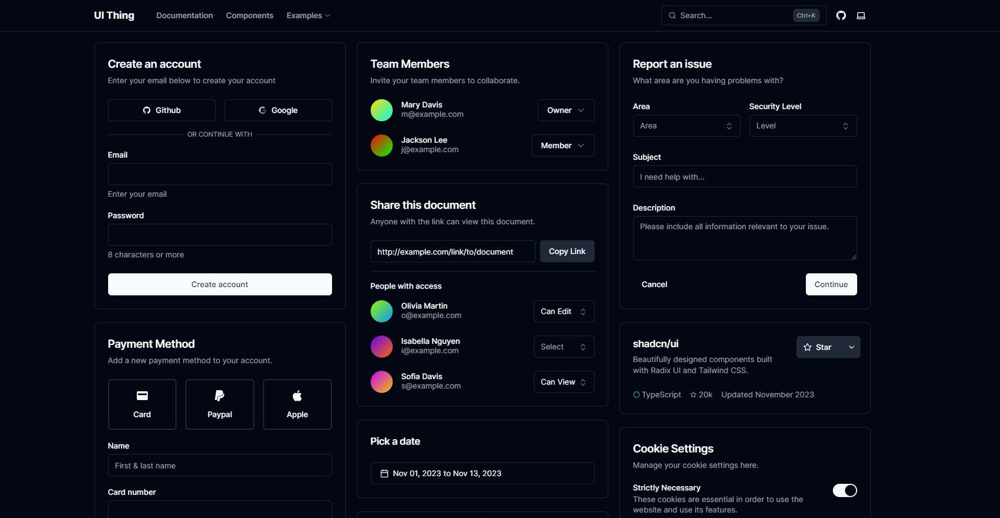

# UI Thing

A modern set of Nuxt components built with Reka UI & TailwindCSS

Inspired by [shadcn/ui](https://ui.shadcn.com/) & [shadcn-vue](https://www.shadcn-vue.com/).



## 📖 Documentation

[🔗 **You can read the full docs here**](https://uithing.com/)

## Agent Skill

This repo also ships an installable `uithing` agent skill for the open skills ecosystem.

Install it from this repo with:

```bash
npx skills add https://github.com/BayBreezy/ui-thing --skill uithing
```

The skill teaches agents to plan, install and build Nuxt apps with UI Thing: the CLI (including non-interactive use), blocks, components, forms, themes, third-party registries and the MCP server.

The authoring copy lives in [`.agents/skills/uithing`](./.agents/skills/uithing) and the installable copy in [`skills/uithing`](./skills/uithing). After editing the authoring copy, refresh the installable one with:

```bash
bun run sync:skills
```

[`skills/uithing/evals/evals.json`](./skills/uithing/evals/evals.json) holds prompts with checkable expectations for testing the skill.

## MCP Server

UI Thing has an MCP server at `https://uithing.com/mcp` that gives AI assistants component and block source, docs, install plans and page/app planning. See the [MCP docs](https://uithing.com/getting-started/mcp) for client setup.

## 🚀 Quick Start

Create a Nuxt project (skip this if you have one):

```bash
npx nuxi@latest init my-app
cd my-app
```

Initialize UI Thing (add `--yes` to accept the defaults without questions):

```bash
npx ui-thing@latest init
```

Add components by name, or run `add` with no names to pick from a list:

```bash
npx ui-thing@latest add button card dialog
```

Start the dev server:

```bash
npm run dev
```

See the [setup guide](https://uithing.com/getting-started/setup) and the [CLI reference](https://uithing.com/getting-started/cli) for everything else.

## ⚡️ Commands

| Command     | Description                                                                         |
| ----------- | ----------------------------------------------------------------------------------- |
| `init`      | Install dependencies and configure your project.                                    |
| `add`       | Add components by name, or from shadcn-style registries (URL or `@namespace/item`). |
| `registry`  | List, search and configure third-party registries such as Vue Bits and NXUI.        |
| `block`     | Add pre-built page sections (hero, pricing, dashboards, auth, settings and more).   |
| `theme`     | Apply a color theme to your project.                                                |
| `list`      | List available or installed components.                                             |
| `update`    | Re-fetch installed components and overwrite them with the latest version.           |
| `remove`    | Remove installed components.                                                        |
| `prettier`  | Add Prettier config for consistent formatting.                                      |
| `shortcuts` | Add keyboard shortcut composables.                                                  |

Prose components for Nuxt Content docs (callouts, steps, tabs and more) ship with the [docd](https://github.com/BayBreezy/docd) layer, not the CLI.

## 🎨 Credits

Huge thanks to the projects that inspired or power this library:

- [shadcn/ui](https://ui.shadcn.com/)
- [Reka UI](https://www.reka-ui.com/)
- [Tailwind CSS](https://tailwindcss.com/)
- [Nuxt](https://nuxt.com/)
- [Nuxt UI](https://ui.nuxt.com)

## 💸 Support Me

If this project helps you, consider supporting:

<a href="https://buymeacoffee.com/llehXIrI8g" target="_blank"></a>
